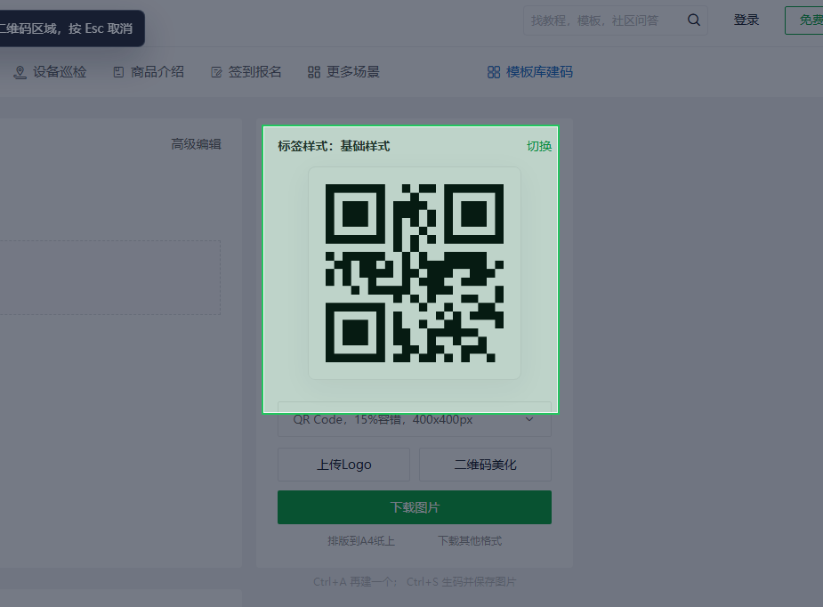
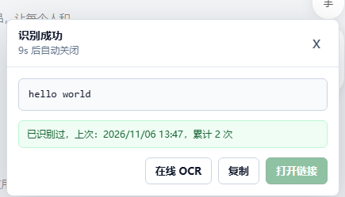
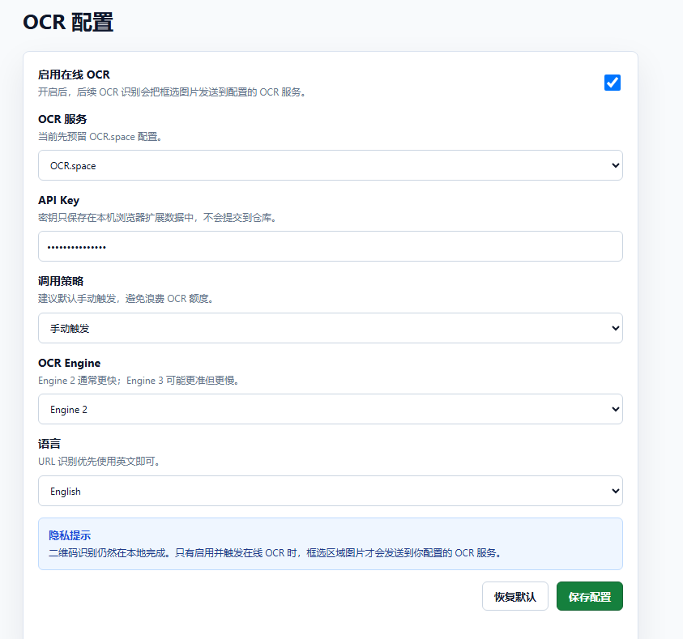

<p align="center">
  
</p>

# QR Region Scanner

[](manifest.json)

[](manifest.json)
[](#隐私说明)
[](#在线-ocr可选)

**框选网页中的二维码，在本地识别文本或链接。**

一个适用于 Chrome / Edge 的浏览器扩展：点击工具栏图标，拖拽框选当前网页可见区域，即可识别二维码、复制结果或打开链接。也可按需接入 OCR.space，从图片文字中提取网址。

二维码识别无需联网；在线 OCR 默认关闭。项目使用原生 JavaScript、HTML 和 CSS，无需构建即可加载。

## 功能亮点

| 功能 | 说明 |
| --- | --- |
| 框选即扫描 | 点击插件图标直接进入框选，支持按 `Esc` 取消 |
| 本地二维码识别 | 优先使用 `BarcodeDetector`，失败时自动回退到内置 `jsQR` |
| 图像增强重试 | 自动尝试补白边、放大、对比度增强和二值化，辅助识别浅色、渐变及低对比度二维码 |
| 结果快捷操作 | 支持复制文本，或在新标签页打开 `http/https` 链接 |
| 倒计时关闭 | 结果面板展示 10 秒后自动关闭，也可手动关闭 |
| 重复识别提醒 | 展示上次识别时间和累计次数，本地最多保存 1000 条不同内容 |
| 可选在线 OCR | 手动识别图片中的网址，或在符合条件的横向选区上自动触发 |

## 运行截图

### 框选二维码

点击插件图标后，拖拽选中完整二维码；绿色边框标出选区，按 `Esc` 可取消。



### 查看识别结果

结果面板展示识别内容、自动关闭倒计时和重复识别提醒。下图识别到的是纯文本 `hello world`，因此“打开链接”按钮不可用。



OCR 配置界面的截图见下方[在线 OCR](#在线-ocr可选)说明。

## 安装

1. 下载本仓库并解压，或使用 Git 克隆：

   ```bash
   git clone https://github.com/yyy-router/qr-region-scanner.git
   ```

2. 打开对应浏览器的扩展管理页：

   | 浏览器 | 地址栏输入 |
   | --- | --- |
   | Chrome | `chrome://extensions/` |
   | Edge | `edge://extensions/` |

3. 开启**开发者模式**，点击**加载已解压的扩展程序**。
4. 选择包含 `manifest.json` 的项目根目录。
5. 在浏览器扩展菜单中固定 **QR Region Scanner**，方便从工具栏启动。

修改插件文件后，请在扩展管理页点击“重新加载”，并刷新目标网页。

## 使用

1. 打开包含二维码的网页，将二维码滚动到可见区域。
2. **左键点击插件图标**，进入框选模式。
3. 拖拽框选完整二维码，尽量包含四周留白，松开鼠标开始识别。
4. 在结果面板中复制内容，或打开识别出的链接。

框选区域过小时会提示重新选择；识别失败时可扩大选区后重试。结果面板默认在 10 秒后关闭，在线 OCR 处理期间暂停倒计时，完成后重新开始计时。

## 在线 OCR（可选）

适合图片中直接显示网址、需要从文字中提取链接的场景。**当前仅支持 OCR.space，默认关闭，需要自行填写 API Key。**

### 配置方式

1. **右键点击浏览器工具栏中的插件图标**，选择“配置 OCR”。
2. 勾选“启用在线 OCR”，填写 OCR.space API Key。
3. 选择调用策略、识别引擎和语言，点击“保存配置”。
4. 返回网页重新框选，在结果面板点击“在线 OCR”，或按自动策略触发。



### 配置项

| 配置项 | 默认值 | 说明 |
| --- | --- | --- |
| 启用在线 OCR | 关闭 | 开启后结果面板显示“在线 OCR”按钮；未填写 API Key 时按钮不可用 |
| OCR 服务 | OCR.space | 当前仅接入该服务 |
| API Key | 空 | 保存在本机浏览器扩展数据中 |
| 调用策略 | 手动触发 | 具体行为见下表 |
| OCR Engine | Engine 2 | 可选择 Engine 2 或 Engine 3 |
| 语言 | English | 可选择英文或简体中文 |

| 调用策略 | 当前行为 |
| --- | --- |
| 手动触发 | 点击结果面板中的“在线 OCR”按钮后调用 |
| 横向长条自动 OCR | 启用并填写 API Key 后，选区宽高比 ≥ 1.8 且未识别到二维码时自动调用 |
| 二维码失败后提示 OCR | 当前与手动模式行为相同，没有单独的提示逻辑 |

### 识别结果

- OCR 返回文字后，插件提取网址、修正常见全角标点和协议格式，并对链接去重；没有协议的域名会补上 `https://`。
- 可一次展示多个链接并一并复制。点击“打开链接”时，优先打开二维码中的有效链接，否则打开首个 OCR 链接。
- 当前仅展示提取出的链接，不提供完整 OCR 文字查看功能。
- 请求失败时会显示错误信息；网络异常、超时和部分 HTTP 错误最多自动重试 2 次。

## 隐私说明

| 数据或操作 | 处理方式 |
| --- | --- |
| 网页截图 | 浏览器先截取当前可见视口，再在本地裁剪选区；裁剪会包含选区周围少量像素，以保留二维码边缘 |
| 二维码识别 | 截图裁剪、图像增强和二维码解码均在本地进行，不调用第三方识别接口 |
| 在线 OCR | 仅在启用并手动触发，或满足所选自动策略时，向 OCR.space 发送 API Key 和裁剪、压缩后的选区图片 |
| 历史与配置 | 通过 `chrome.storage.local` 保存在本机浏览器扩展数据中 |

OCR 上传的是裁剪后的区域图片，不读取或上传网页 DOM。图片会先进行尺寸调整、灰度与对比度处理，再压缩为 JPEG。

历史记录按识别内容去重，保存首次识别时间、最近识别时间和累计次数，最多保留最近识别的 1000 条。当前提供重复识别提醒，尚无历史列表、搜索、导出或清空界面。OCR 提取到多个链接时，仅额外记录首个与当前二维码结果不同的链接。

## 工作原理与项目结构

扫描流程：点击图标 → 按需注入脚本 → 框选区域 → 截图并本地裁剪 → 原图解码 → 图像增强后重试 → 保存历史并展示结果。

本地解码优先使用浏览器内置 `BarcodeDetector`；不可用或识别失败时使用内置的 `jsQR@1.4.0`。二维码识别不依赖服务端，也无需从 CDN 加载解码库。

| 文件 | 职责 |
| --- | --- |
| [manifest.json](manifest.json) | Manifest V3 配置、扩展权限、图标和页面入口 |
| [background.js](background.js) | 工具栏与右键菜单、脚本注入、可见视口截图、OCR 请求与重试 |
| [content.js](content.js) | 框选交互、图片裁剪、二维码解码、图像增强、历史记录、OCR 链接提取和结果面板 |
| [content.css](content.css) | 框选遮罩、选区和结果面板样式 |
| [options.html](options.html) / [options.js](options.js) / [options.css](options.css) | OCR 配置界面、配置读写及样式 |
| [vendor/jsQR.js](vendor/jsQR.js) | 内置的本地二维码解码库 |
| [images/](images/) | README 使用的运行截图 |

扩展声明的权限包括 `activeTab`、`scripting`、`storage` 和 `contextMenus`，分别用于当前标签页操作、脚本与样式注入、本地存储和插件右键菜单；OCR 的主机权限限定为 `https://api.ocr.space/*`。

## 常见问题与限制

**点击图标后没有出现框选，或图标显示 `ERR`？**

请切换到普通网页重试。浏览器内置页面、扩展商店等特殊页面通常不允许脚本注入或截图。更新插件后，也需要重新加载扩展并刷新网页。

**二维码识别失败？**

请确保二维码完整可见，并适当放大网页或扩大选区，保留二维码四周留白。过小、模糊、遮挡或对比度过低的二维码仍可能识别失败；一次扫描只返回一个二维码结果。

**为什么没有“在线 OCR”按钮，或按钮不可点击？**

请在配置页启用在线 OCR 并保存。启用后按钮会显示，填写 API Key 后才能调用；配置修改后请重新框选。

**OCR 提示网络错误或超时？**

单次请求超时时间为 20 秒，符合条件的错误会自动重试。请检查 API Key、服务额度，以及当前网络或代理是否允许访问 `api.ocr.space`。

**能否扫描整页、离屏二维码，或打开任意协议的内容？**

目前只扫描当前可见区域，离屏内容需要先滚动到视口内。“打开链接”仅支持 `http` 和 `https`；其他内容可以复制。

## 第三方许可

本项目内置 `jsQR@1.4.0`，其 Apache-2.0 许可证见 [vendor/jsQR.LICENSE](vendor/jsQR.LICENSE)。该许可证说明针对内置的第三方库。
